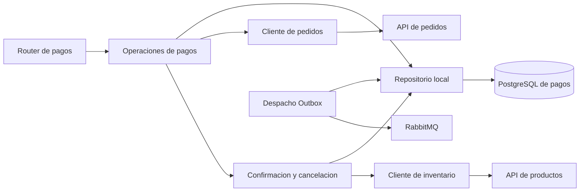

# Segunda etapa: procesamiento de pagos

Se amplía la separacion iniciada en pedidos y carrito. RNF-08 y RNF-21 siguen
**Parciales**: faltan otras areas del backend y migraciones versionadas.

## Responsabilidades

| Modulo de payment-service/app | Responsabilidad |
| --- | --- |
| `routers/payments.py` | Rutas, autenticacion, validacion de entrada y respuestas publicas |
| `payment_actions.py` | Crear/consultar intentos y coordinar cancelaciones |
| `payment_repository.py` | Consultas locales, bloqueo por pedido, filas bloqueadas y seleccion de Outbox; sin commits ni HTTP |
| `order_client.py` | Contratos propios del consumidor para pedidos publicos e internos, timeout y autenticacion |
| `inventory_client.py` | Reservar por transaction_id y confirmar liberacion por order_id; respuestas ambiguas no autorizan transiciones |
| `inventory.py`, `cancellations.py`, `outbox.py` | Transiciones y recuperacion durable; delegan consultas al repositorio y HTTP a los adaptadores |

## Comportamiento conservado

- Mismo bloqueo PostgreSQL por pedido en creacion, recuperacion y cancelacion.
- El intento PENDING y su snapshot se confirman antes de llamar al inventario.
- La misma transaccion confirma PAID y sus tres entregas Outbox.
- Reserva reutilizada al recuperar respuestas perdidas; sin nuevos reintentos
  automaticos de POST por parte del cliente HTTP.
- Lecturas privadas por propietario; consulta del ultimo intento ordenada por ID.
- Confirmaciones de inventario equivocadas mantienen el estado recuperable.

El consumidor de pedidos valida un contrato local, no importa modelos ni accede
a la base del otro microservicio. Un JSON incompatible, ID distinto, importe
invalido o items repetidos no crea un intento de pago ni efectos en inventario.
Los rechazos de negocio mantienen sus codigos; una respuesta remota incompatible
se trata como indisponibilidad controlada.

## Pruebas nuevas

La suite incluye los casos de contratos de pedidos incompatibles sin pagos ni
Outbox, cancelacion interna invalida sin registro de cancelacion y liberacion
equivocada que permanece PENDING hasta recibir una confirmacion valida.
Tambien integra las tres pruebas de consulta privada del ultimo intento.

La verificacion final se refleja en la [suite backend](auditoria/resultado-suite.json),
[pagos en navegador](frontend/pagos.json), [instalacion con frontend](frontend/instalacion-desde-cero.json)
y [pruebas con replicas](escalabilidad/README.md). Las fechas y hashes identifican
las ejecuciones; no se suman escenarios de distintas suites como una misma corrida.

## Pendientes de RNF-08 y RNF-21

Extender la separacion a usuarios/productos y al checkout/recuperadores de pedidos;
extender contratos a cancelacion desde pedidos y validacion de eventos; reducir
el uso de objetos HTTP en la aplicacion; sustituir el bootstrap de esquema por
migraciones versionadas en usuarios, pedidos y pagos. No se declara cumplimiento
integral por completar esta segunda etapa.
