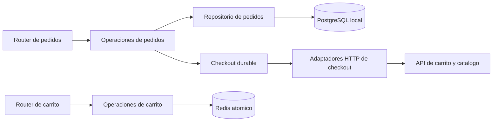

# Modularidad y contratos: primera etapa

Esta etapa mejora RNF-08 y RNF-21. Ambos conservan estado **Parcial**:
no se cierra la modularidad de todos los microservicios por reorganizar pedidos
y carrito. La matriz sigue en 72 cumplidos, 6 parciales y 0 pendientes.

## Cambios

El checkout y los recuperadores aun mantienen SQL directo; el diagrama muestra
la separacion incorporada, no una migracion completa de toda la persistencia.

- `order-service/app/routers/orders.py`: validacion HTTP, autorizacion y respuestas.
- `order-service/app/order_actions.py`: casos de uso y limites de transaccion.
- `order-service/app/order_repository.py`: consultas locales y bloqueo de filas,
  sin llamadas HTTP ni commits propios. El historial copia su respuesta y libera
  la conexion de lectura antes de serializarla, como antes.
- `cart-service/app/cart_operations.py`: altas, cambios, borrado y vaciado con
  las mismas operaciones atomicas Redis. El router delega las operaciones.
- `order-service/app/checkout_clients.py`: protocolos HTTP del checkout con
  timeouts, autenticacion y errores identificables. Un producto con contrato
  incompatible no se convierte en un pedido: el checkout queda recuperable.
  Un carrito con estructura incompatible devuelve indisponibilidad controlada.

Los contratos del adaptador son propios del consumidor. No se importan modelos
ni se accede a las bases de otro servicio. Se mantiene la validacion autoritativa
de precio, actividad y stock y el protocolo versionado del carrito: estas
dependencias son necesarias para la consistencia actual y no se eliminan
simplemente reemplazando todas las llamadas por eventos.

## Inicializacion y consumidores

Usuarios, pedidos y pagos crean su esquema mediante `initialize_schema()` al
entrar al lifespan, antes de aceptar trafico o arrancar sus workers. Importar
ASGI ya no crea tablas. `create_all` sigue siendo un bootstrap, no un sistema
de migraciones para esos tres servicios. Productos conserva Alembic.

Pedidos y productos arrancan el consumidor RabbitMQ dentro del lifespan.
Reciben una señal de parada y procesan eventos en su propio hilo; cierran la
conexion al salir. La espera de cierre del hilo es acotada: no se promete una
parada instantanea si hay una llamada remota en curso. Los otros servicios
conservan sus workers de lifespan existentes.

## Verificacion

`tests/run_stability.ps1` comprueba primero, en un proceso nuevo para cada uno
de los seis servicios, que importar ASGI no abra SQL/sockets ni arranque hilos.
La regresion de checkout agrega contratos incompatibles de catalogo y carrito,
ausencia de pedidos creados y recuperacion al restaurar el contrato.

Se conservan los contratos HTTP del frontend, estados, permisos, claves de
idempotencia, bloqueos y puntos de commit. Los informes de esta etapa deben
identificarse por fecha y hashes: las pruebas previas no se presentan como
ejecutadas sobre este refactor.

## Trabajo restante

1. Separar coordinacion y persistencia en pagos y en los otros routers que aun
   contienen negocio/SQL, asi como en checkout y recuperadores que todavia
   consultan SQL directamente; reducir tambien el acoplamiento del codigo de aplicacion
   a excepciones y objetos HTTP.
2. Extender los adaptadores con contratos explicitos a cancelaciones y validacion
   de eventos. Los timeouts y reintentos deben conservar la recuperacion durable.
3. Sustituir el bootstrap `create_all` de usuarios/pedidos/pagos por migraciones
   versionadas y un paso de despliegue explicito, sin efectos al importar.

La extraccion actual permite avanzar en estos puntos con cambios menores y
pruebas separadas; no implica que se hayan completado.

## Resultados sobre f94fed0

| Comprobacion | Resultado |
| --- | --- |
| [Suite backend](auditoria/resultado-suite.json) | 155 unittest y seis importaciones ASGI sin efectos; HTTP, TTL/DLQ y gateway aprobados |
| [Instalacion y frontend](frontend/instalacion-desde-cero.json) | 14 contenedores nuevos, migraciones, reinicio, nueve etapas UI y 14 estados axe sin incidencias |
| [Concurrencia e independencia](escalabilidad/independencia.json) | Checkout/pago con 12 solicitudes por operacion, cancelacion concurrente y seis servicios escalados 2/3/1/2 |
| [Carga con replicas](escalabilidad/carga/resultado.json) | 18.235 solicitudes medidas. 1.052 compras con calentamiento y 30 objetivos aprobados |

Todos los proyectos UUID de prueba fueron eliminados y conservaron la instalacion habitual al ejecutarse. Los 56 escenarios GUI previos mantienen su fecha; el recorrido de instalacion se reejecuto sobre este codigo. RNF-08 y RNF-21 siguen parciales.
